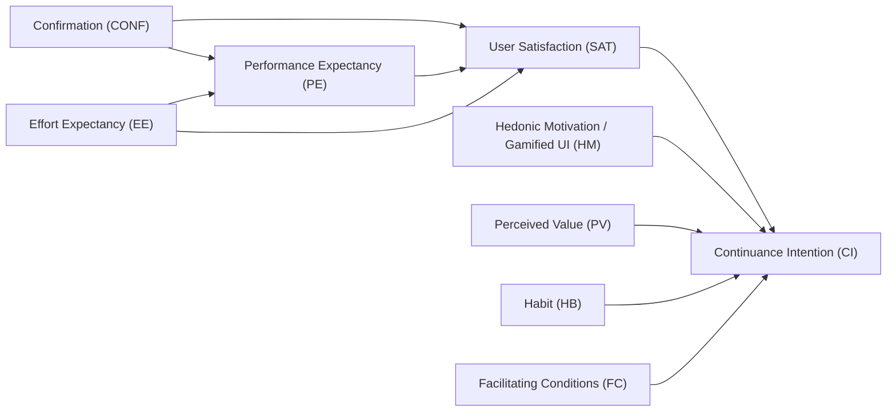

# Masterplan Riset Ilmiah (SINTA 2 & Scopus): Bidang Bisnis Digital
**Platform Objek Riset:** ProPePa PEDULI LMS (EdTech Platform Ecosystem)  
**Lokus Empiris:** Seluruh Sekolah Dasar (SD Negeri & Swasta) se-Kota Cimahi, Jawa Barat

---

## 🎯 1. Executive Summary & Kekuatan Riset Skala Kota

Dokumen ini merinci cetak biru riset akademik untuk mempublikasikan evaluasi platform **ProPePa PEDULI** ke jurnal bereputasi **SINTA 2** dan **Scopus (Q1/Q2)** pada rumpun **Bisnis Digital / Sistem Informasi Manajemen**.

> [!IMPORTANT]
> **Nilai Kebaruan Utama (Scientific Novelty & Competitive Edge):**
> Sebagian besar publikasi EdTech di Indonesia memiliki kelemahan metodologis berupa *sample bias* (hanya diuji pada 1 sekolah atau 30–40 siswa). ProPePa diimplementasikan pada **skala satu kota penuh (seluruh SD di Kota Cimahi)** yang melibatkan tiga kecamatan (Cimahi Selatan, Cimahi Tengah, Cimahi Utara). 
> Hal ini memposisikan riset bukan lagi sekadar rekayasa perangkat lunak biasa, melainkan **Studi Empiris Adopsi Platform Digital Skala Kota (*Municipal-Scale Government-Backed Digital Platform Adoption*)** yang sangat dicari oleh reviewer jurnal internasional.

---

## 📌 2. Dua Opsi Arah Manuskrip (Draft 1 & Draft 2)

### Opsi A: Draft 1 (Paling Direkomendasikan untuk Publikasi Cepat & Solid)
* **Tema:** *Platform Adoption & Continuance Intention* (Model UTAUT-2 + Expectation-Confirmation Model/ECM).
* **Fokus Masalah:** Apa yang mendorong guru-guru SD di Kota Cimahi untuk terus menggunakan platform ini secara sukarela dan berkelanjutan pasca-mandat awal dinas?
* **Usulan Judul Scopus (Q1/Q2):**
  > *"Unlocking Continuance Intention in Municipal-Scale EdTech Platforms: A Cross-School Empirical Synthesis of UTAUT2 and Expectation-Confirmation Theory in Cimahi City"*
* **Usulan Judul SINTA 2:**
  > *"Faktor Pendorong Niat Penggunaan Berkelanjutan Platform EdTech ProPePa: Studi Empiris Skala Kota pada Guru Sekolah Dasar di Kota Cimahi"*

### Opsi B: Draft 2 (Fokus Interaktivitas & Keterlibatan Digital)
* **Tema:** *Gamification Marketing & Digital Customer Engagement* (Kerangka S-O-R: *Stimulus-Organism-Response*).
* **Fokus Masalah:** Bagaimana elemen poin, *badges*, papan peringkat, dan papan argumen interaktif memicu *flow experience* dan *digital engagement* pada guru/siswa.
* **Usulan Judul Scopus (Q1/Q2):**
  > *"Stimulating Digital Engagement in Municipal EdTech Ecosystems: A Stimulus-Organism-Response Analysis of Gamification Mechanics across Primary Education"*
* **Usulan Judul SINTA 2:**
  > *"Pengaruh Elemen Gamifikasi terhadap Keterlibatan Pengguna dan Loyalitas Platform Digital: Pendekatan S-O-R pada Komunitas Guru SD se-Kota Cimahi"*

---

## 🧩 3. Model Konseptual Riset (Draft 1: UTAUT2 + ECM)

### Matriks Hipotesis:
* **H1:** *Confirmation* berpengaruh positif signifikan terhadap *User Satisfaction*.
* **H2:** *Confirmation* berpengaruh positif signifikan terhadap *Performance Expectancy*.
* **H3:** *Performance Expectancy* (peningkatan efektivitas asesmen P5) berpengaruh positif terhadap *User Satisfaction*.
* **H4:** *Effort Expectancy* (kemudahan pengoperasian siklus PEDULI) berpengaruh positif terhadap *Performance Expectancy*.
* **H5:** *User Satisfaction* berpengaruh positif signifikan terhadap *Continuance Intention*.
* **H6:** *Hedonic Motivation* (kesenangan elemen visual & poin) berpengaruh positif terhadap *Continuance Intention*.
* **H7:** *Perceived Value* (kemanfaatan sistem sebanding dengan waktu kerja) berpengaruh positif terhadap *Continuance Intention*.
* **H8:** *Habit* (kebiasaan harian/mingguan membuka jurnal ProPePa) berpengaruh positif terhadap *Continuance Intention*.
* **H9:** *Facilitating Conditions* (dukungan sarana gawai, internet sekolah) berpengaruh positif terhadap *Continuance Intention*.

---

## 👥 4. Desain Sampling & Pengumpulan Data

1. **Populasi Sasaran:** Guru SD (Wali Kelas & Guru Pembimbing Proyek P5) di seluruh SD Negeri & Swasta di Kota Cimahi.
2. **Kalkulasi Sampel Minimum:**
   * Jumlah indikator dalam model = 26 butir.
   * Rasio sampel minimum SEM: $5 \times \text{jumlah indikator} = 130$ responden; rasio ideal: $10 \times \text{jumlah indikator} = 260$ responden.
   * **Target Pengumpulan Data:** **200 – 300 Guru SD** se-Kota Cimahi.
3. **Teknik Penarikan Sampel:** *Stratified Cluster Sampling* berdasarkan 3 kecamatan di Kota Cimahi:
   * Klaster 1: SD di Kecamatan Cimahi Selatan (~35% sampel)
   * Klaster 2: SD di Kecamatan Cimahi Tengah (~35% sampel)
   * Klaster 3: SD di Kecamatan Cimahi Utara (~30% sampel)

---

## 💻 5. Prosedur Analisis Data (PLS-SEM SmartPLS 4 / WarpPLS)

1. **Outer Model (Measurement Model Evaluation):**
   * *Convergent Validity:* Outer loading $> 0.708$, AVE $> 0.50$.
   * *Discriminant Validity:* Fornell-Larcker criterion & HTMT ratio $< 0.85$ (konservatif) atau $< 0.90$.
   * *Construct Reliability:* Cronbach’s Alpha $> 0.70$ dan Composite Reliability (rho_a, rho_c) $> 0.70$.
2. **Inner Model (Structural Model Evaluation):**
   * Nilai $R^2$ untuk *Satisfaction* ($R^2 \ge 0.50$ = moderat/kuat) dan *Continuance Intention* ($R^2 \ge 0.60$ = kuat).
   * Nilai $f^2$ (effect size) untuk melihat besaran kontribusi per variabel independen.
   * Relevansi prediktif $Q^2$ menggunakan *PLSpredict*.
   * Pengujian hipotesis via *Bootstrapping* (5.000 subsamples, *two-tailed test*, $t > 1.96, p < 0.05$).

---

## 🎯 6. Target Jurnal Tujuan

### Target Scopus (Kategori: Business, Management, E-Commerce, Information Systems)
* **Computers in Human Behavior** (Elsevier, Scopus Q1, SJR tinggi) – Sangat kuat untuk riset psikologi pengguna teknologi digital.
* **Journal of Theoretical and Applied Electronic Commerce Research (JTAER)** (MDPI, Scopus Q1) – Cepat dalam proses *peer-review* untuk riset adopsi layanan digital.
* **Cogent Business & Management** (Taylor & Francis, Scopus Q2) – Terbuka luas untuk riset bisnis digital dan adopsi inovasi di negara berkembang.
* **Electronic Commerce Research and Applications** (Elsevier, Scopus Q1/Q2) – Fokus pada platform digital dan retensi pengguna.

### Target SINTA 2 (Kategori: Sistem Informasi Bisnis & Manajemen Teknologi)
* **Jurnal Sistem Informasi (JSI)** – Fasilkom Universitas Indonesia (SINTA 2).
* **Jurnal Manajemen Teknologi (JMT)** – SBM Institut Teknologi Bandung (SINTA 2).
* **Jurnal Aplikasi Manajemen (JAM)** – Universitas Brawijaya (SINTA 2).
* **Jurnal Dinamika Manajemen (JDM)** – Universitas Negeri Semarang (SINTA 2).
* **Register: Jurnal Ilmiah Teknologi Sistem Informasi** (SINTA 2).
